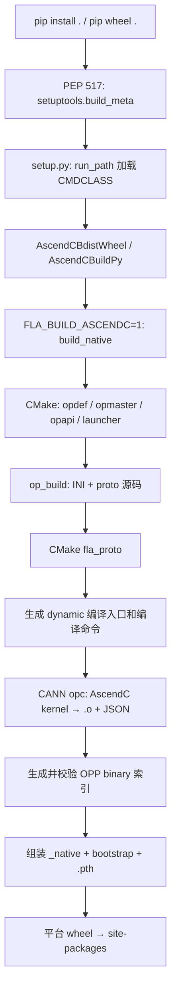
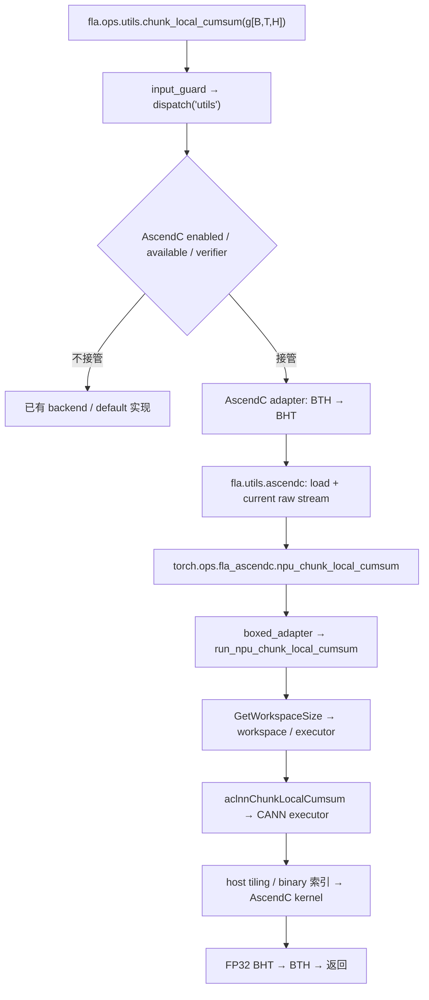

# chunk_local_cumsum AscendC 最小迁移 PoC 方案与验证记录

本文记录 `fla-npu → fla-org` 的首个 AscendC 算子迁移 PoC，包括目录组织、文件变更、pip 构建、运行调用链及实际故障修复。内容以当前 `ascendc-cumsum-poc` 分支工作区和 2026-10-15 的 950PR 验证产物为准。

**结果：完整 FLA 仓库的 native wheel 已编译、安装并在 Ascend950PR_9579 上运行通过；6 个公开 API Demo 用例及 438 项 AscendC 专项测试通过。** 该结论限定于下文的输入、环境和测试范围，不代表全仓测试、训练或性能验证通过。

## 1. 迁移目标与实现边界

迁移后，用户继续调用 `fla.ops.utils.chunk_local_cumsum`，由 FLA 现有 backend registry 和 verifier 选择 AscendC。算子源文件随所属算子放置，共享桥接代码单独管理；构建入口仍为 pip/setuptools，通过显式开关生成包含 OPP 和 kernel 二进制的 wheel。

源代码基线：

| 项目          | 基线或位置                                                             |
| ----------- | ----------------------------------------------------------------- |
| 目标仓 FLA     | `1fe52b5d05c53601885610fab3d39157647d836d`                        |
| 来源仓 fla-npu | `066f47e4f1c41f8a2227142f3114bc60c4554dee`                        |
| 当前分支        | `ascendc-cumsum-poc`，PoC 修改位于工作区                                  |
| 本地目标仓       | `/Users/chenjingxiang/Workspace/codes/flash-linear-attention`     |
| 本地来源仓       | `/Users/chenjingxiang/Workspace/codes/flash-linear-attention-npu` |
| 远端验证根目录     | `/home/c00788566/workspace/fla-ascendc-cumsum-poc`                |

### 1.1 数学语义与支持范围

对于输入 `g[B,T,H]`、chunk 长度 `C` 和缩放系数 `s`，每个 chunk 内独立做前缀和：

```text
start(t) = floor(t / C) * C
y[b,t,h] = s * sum(g[b,i,h], i=start(t)..t)
```

`scale=None` 时 `s=1`；最后不足一个 chunk 的部分仍正常计算。

| 条件         | AscendC PoC 接管范围                                                    |
| ---------- | ------------------------------------------------------------------- |
| 设备         | Ascend950 系列 NPU；实际验证为 Ascend950PR_9579                             |
| 输入         | 非空 dense 三维 `[B,T,H]`，`torch.strided`；支持连续及非连续输入                    |
| 输入 dtype   | `float32`、`float16`、`bfloat16`                                      |
| 输出 dtype   | 仅 `torch.float32`；包括公共入口默认值，显式 `output_dtype=None` 不接管              |
| chunk_size | 整数 `64` 或 `128`                                                     |
| scale      | `None`，或有限且不超过 FP32 最大绝对值的 Python `int/float`                       |
| 方向         | `reverse=False`                                                     |
| 元数据        | `cu_seqlens=None`、`chunk_indices=None`、`use_graph=False`，无额外 kwargs |
| 梯度         | 未注册 backward；启用梯度且输入 `requires_grad=True` 时不接管                      |
| 启用方式       | native wheel 已安装，启动 Python 前设置 `FLA_ASCENDC=1`                      |

不满足 verifier 的调用继续走已有 backend/default 路径；这不是承诺已有路径支持所有非法输入。已经选中 AscendC 后发生的加载、执行错误直接上报，不吞掉异常后静默回退。

### 1.2 保留原 kernel，通过 adapter 对齐 FLA 布局

来源算子的 8 个 `op_host/op_kernel` 文件按原内容迁入，未改写数值算法。FLA 的公开三维布局为 `[B,T,H]`；本 PoC 调用原生实现的 `head_first=True` 路径：

```text
FLA 输入 [B,T,H]
  → input_guard 处理连续性与设备上下文
  → transpose(1,2).contiguous() 得到 [B,H,T]
  → AscendC 原实现，FP32 输出 [B,H,T]
  → transpose(1,2).contiguous() 返回 [B,T,H]
```

这包含布局转换和复制开销。本次目的是验证集成闭环，没有据此作性能提升结论。

## 2. 文件迁移与修改清单

以下路径均相对目标仓根目录。原算子目录为来源仓的 `fla/ops/ascendc/gdn/chunk_gdn_fwd/chunk_local_cumsum/`。

### 2.1 修改现有文件

| 文件                                   | 修改内容及作用                                                                                               |
| ------------------------------------ | ----------------------------------------------------------------------------------------------------- |
| `pyproject.toml`                     | 显式指定 `build-backend = "setuptools.build_meta"`，沿用 setuptools/wheel 的构建依赖入口                            |
| `setup.py`                           | 通过 `run_path` 加载 `build_helpers/ascendc.py` 的 `CMDCLASS`；启用 package data；包发现限定为 `fla`、`fla.*`；声明许可证文件 |
| `scripts/build_packages.py`          | 拆分 `fla-core` 时带入 helper、共享 csrc、manifest、许可证及 Demo；生成的 core setup 同样加载构建命令；复制时排除 `_native`           |
| `fla/ops/utils/backends/__init__.py` | 导入并导出 `AscendCUtilsBackend`，使其进入已有注册流程                                                                |
| `tests/ops/utils/test_cumsum.py`     | 新增 dense 精度、回退及非默认 stream 用例，检查真实 native 路由                                                           |
| `.gitignore`                         | 忽略 `fla/utils/ascendc/_native/` 生成物                                                                   |

`fla/ops/utils/cumsum.py` 的公开入口、原 Triton 算法和公共签名不需要修改；`fla/backends.py` 的通用 dispatch 机制也没有为此另建分支。现有 `build.sh` 未修改。

### 2.2 新增算子所属文件

目录前缀：`fla/ops/utils/backends/ascendc/`。

| 文件                                                                    | 职责                                                                                                         |
| --------------------------------------------------------------------- | ---------------------------------------------------------------------------------------------------------- |
| `__init__.py`                                                         | `AscendCUtilsBackend` 注册、开关、优先级和可用性判断                                                                      |
| `cumsum.py`                                                           | 输入 verifier；FLA `[B,T,H]` 与原生 `[B,H,T]` 的双向适配                                                              |
| `README.md`                                                           | 当前支持范围、构建及运行方式                                                                                             |
| `csrc/chunk_local_cumsum/stable_chunk_local_cumsum.cpp`               | 将 Stable ABI tensor 参数转换为 ACLNN 调用；由来源仓 `torch_custom/fla_npu/csrc/src/stable_chunk_local_cumsum.cpp` 迁移适配 |
| `csrc/chunk_local_cumsum/op_host/chunk_local_cumsum_def.cpp`          | 算子输入输出、属性和目标配置定义                                                                                           |
| `csrc/chunk_local_cumsum/op_host/chunk_local_cumsum_tiling.cpp`       | host tiling、tiling key 与执行参数                                                                               |
| `csrc/chunk_local_cumsum/op_host/chunk_local_cumsum_infershape.cpp`   | shape/dtype 推导注册                                                                                           |
| `csrc/chunk_local_cumsum/op_host/op_api/aclnn_chunk_local_cumsum.cpp` | ACLNN 两阶段接口实现                                                                                              |
| `csrc/chunk_local_cumsum/op_host/op_api/aclnn_chunk_local_cumsum.h`   | ACLNN 接口声明                                                                                                 |
| `csrc/chunk_local_cumsum/op_host/op_api/chunk_local_cumsum.cpp`       | l0op 层 AICore launcher 注册及调用                                                                               |
| `csrc/chunk_local_cumsum/op_kernel/chunk_local_cumsum.cpp`            | AscendC device kernel                                                                                      |
| `csrc/chunk_local_cumsum/op_kernel/chunk_local_cumsum_tiling_data.h`  | host/device 共用 tiling 数据结构                                                                                 |

表中最后 8 个文件保持来源仓内容；原算子目录下的 CMake 构建方式不直接复制，由下面的共享 CMake 接管。

### 2.3 新增共享构建、运行时及依赖文件

| 文件或目录                                                           | 职责                                                                                         |
| --------------------------------------------------------------- | ------------------------------------------------------------------------------------------ |
| `build_helpers/__init__.py`                                     | 构建 helper 包标记                                                                              |
| `build_helpers/ascendc.py`                                      | setuptools 命令、CMake 调用、CANN 代码生成、kernel 编译、OPP 组装和索引检查                                     |
| `build_helpers/bootstrap.py`                                    | 仅依赖标准库的进程启动初始化；为已安装 native wheel 提前设置 OPP 搜索路径                                             |
| `csrc/ascendc/CMakeLists.txt`                                   | 构建 opdef、tiling、opapi、proto 和 PyTorch launcher 动态库                                         |
| `csrc/ascendc/src/registration.cpp`                             | 注册 `torch.ops.fla_ascendc.npu_chunk_local_cumsum`；导出源码 hash 和 stream/queue 诊断接口            |
| `csrc/ascendc/src/runtime.cpp`                                  | 动态库及符号查找缓存；torch_npu 队列接入与直接执行路径                                                           |
| `csrc/ascendc/src/cust_opapi_dlog_stub.cpp`                     | 迁入自定义 opapi 的弱日志符号 shim                                                                    |
| `csrc/ascendc/include/stable/acl_meta.h`                        | ACL tensor 元信息转换                                                                           |
| `csrc/ascendc/include/stable/at_facade.h`                       | 基于 C shim 的 tensor 元信息和分配适配                                                                |
| `csrc/ascendc/include/stable/boxed.h`                           | PyTorch boxed 参数适配                                                                         |
| `csrc/ascendc/include/stable/exec.h`                            | ACLNN workspace/executor 调用、资源生命周期和提交封装                                                    |
| `csrc/ascendc/include/stable/runtime.h`                         | 共享运行时接口声明                                                                                  |
| `csrc/ascendc/include/err/ops_err.h`                            | CANN 错误日志宏适配，保留来源许可                                                                        |
| `csrc/ascendc/include/torch_stable_abi/`                        | PyTorch 2.9 Stable ABI 所需头文件闭包；包含 c10、torch 头文件，以及 `LICENSE`、`MANIFEST.sha256`、`README.md` |
| `fla/utils/ascendc/__init__.py`                                 | 懒加载本安装包的 native 库、校验 hash、获取设备和 stream、调用 torch.ops                                        |
| `MANIFEST.in`                                                   | 将 native 源码、helper、许可证和 Demo 纳入 sdist，排除生成的 `_native`                                      |
| `NOTICE`                                                        | 记录来源仓、版本和不同文件组的许可证归属                                                                       |
| `LICENSES/BSD-3-Clause.txt`                                     | 迁入桥接代码所需许可文本                                                                               |
| `LICENSES/CANN-Open-Software-License-Agreement-Version-2.0.txt` | 原 host/kernel 文件的 CANN 许可文本                                                                |
| `scripts/check_ascendc_cumsum.py`                               | 安装后从 FLA 公共 API 运行 6 个精度用例，并确认实际进入 native adapter                                          |
| `tests/host/test_ascendc.py`                                    | 不依赖 NPU 的 verifier、registry、bootstrap、打包和索引检查                                              |

头文件闭包的逐文件内容由其 `MANIFEST.sha256` 记录，不依赖构建机临时下载。Stable ABI 桥接头并不意味着无需安装 PyTorch：构建和运行仍使用实际环境中的 torch 库，torch_npu 私有队列接口也有版本约束。

本文件 `ASCENDC_CUMSUM_MIGRATION.zh-CN.md` 是验证完成后整理的迁移报告。`build/ascendc-validation/` 是忽略的证据目录，不属于要迁入上游的运行时代码。

## 3. 接入 pip/setuptools 的构建调用链

### 3.1 两个独立开关

| 变量                                   | 阶段             | 含义                                         |
| ------------------------------------ | -------------- | ------------------------------------------ |
| `FLA_BUILD_ASCENDC=1`                | 构建             | 启用 native 编译与打包；不设置时保留纯 Python 构建          |
| `FLA_ASCENDC_SOC=ascend950`          | 构建             | 本 PoC 要求的目标 SoC                            |
| `FLA_ASCENDC_OPS=chunk_local_cumsum` | 构建             | 可省略；当前只接受该单算子                              |
| `MAX_JOBS=8`                         | 构建             | 本次使用的并行度；代码默认 4                            |
| `ASCEND_HOME_PATH`                   | 构建及运行          | 来自 CANN `set_env.sh`                       |
| `FLA_ASCENDC=1`                      | 进程启动及 dispatch | 提前配置 package-local OPP，并启用 AscendC backend |
| `FLA_ASCENDC_OP_API_LIB`             | 运行时内部          | loader 设置为本次安装包内的 `libcust_opapi.so`       |

`FLA_BUILD_ASCENDC` 不控制调用时的 dispatch；`FLA_ASCENDC` 不触发编译。

### 3.2 pip 到设备二进制



具体顺序如下：

1. pip 读取 `pyproject.toml`，调用 `setuptools.build_meta`。`setup.py` 通过脚本绝对路径执行 `build_helpers/ascendc.py`，注入 `build_py`、`bdist_wheel` 两个命令。
2. `AscendCBuildPy.run()` 先复制 Python 文件。native 构建时进入 `build_native()`；该实现明确拒绝 native editable install。
3. `build_native()` 检查 Linux、SoC、算子名和 CANN 生成工具；导入 torch 定位链接库；对共享 native 源码和算子 native 源码计算 hash。
4. 在 `build/ascendc` 配置、执行 CMake。构建环境去掉已有 `ASCEND_CUSTOM_OPP_PATH`、`FLA_NPU_OP_API_LIB` 和 `FLA_ASCENDC_OP_API_LIB`，避免混入旧安装。
5. 调用 CANN `tools/opbuild/op_build`，输入 `libfla_opdef.so`，生成 `autogen/aic-ascend950-ops-info.ini` 和 proto 源码。环境设置 `OPS_PROTO_SEPARATE=1`、`OPS_ACLNN_GEN=0`、`OPS_PROJECT_NAME=aclnn`；ACLNN 使用迁入源码。
6. 构建 `fla_proto`。把 host 库放入绝对路径的 staging OPP，编译阶段的 `ASCEND_CUSTOM_OPP_PATH` 指向它，使编译器能找到本算子的 tiling。
7. 将 INI 转为 OPP ops-info JSON。调用安装版 CANN 的 `ascendc_impl_build.py`，生成 `impl/dynamic/chunk_local_cumsum.py`，并把 kernel 源码复制到 `impl/ascendc/chunk_local_cumsum/`。
8. `ascendc_bin_param_build.py` 生成编译 shell 脚本；并行执行这些脚本，传入 dynamic Python 入口及输出目录。本次 CANN 9.2 工具链最终调用 `opc` 编译 AscendC，生成 device `.o` 和配套 JSON。
9. `ascendc_ops_config.py` 生成二进制索引，组装 `kernel/config/ascend950`。`validate_kernel_index()` 检查 `ChunkLocalCumsum.binaryList` 非空，且每个 `binPath/jsonPath` 都指向包内存在的文件。
10. 写入 `build.json`，复制 launcher；生成顶层 `fla_ascendc_bootstrap.py` 与 `fla_ascendc.pth`。`get_outputs()` 将生成物纳入 wheel。
11. `AscendCBdistWheel` 将 native 包标记为平台 wheel。本次产物为 `py3-none-linux_x86_64`，没有声明 manylinux 兼容性。pip 安装 wheel 时解包已有二进制，不再编译 kernel。

本次实际执行的是 **`pip wheel` 构建 → 安装指定 wheel**，便于记录产物 hash。`pip install . --no-build-isolation --no-deps` 走同一套源码构建入口，但不如保留独立 wheel 便于审计。

### 3.3 CMake 各 target 与产物

| target         | 主要输入                                           | 输出及用途                                          |
| -------------- | ---------------------------------------------- | ---------------------------------------------- |
| `fla_opdef`    | `chunk_local_cumsum_def.cpp`                   | `libfla_opdef.so`，供 `op_build` 提取定义，属于构建中间物    |
| `fla_opmaster` | tiling、infershape                              | `libcust_opmaster_rt2.0.so`，OPP host tiling/推导 |
| `fla_opapi`    | 两个 op_api CPP、日志 shim                          | `libcust_opapi.so`，提供 ACLNN 两阶段接口              |
| `fla_proto`    | `autogen/chunk_local_cumsum_proto.cpp`         | `libcust_opsproto_rt2.0.so`，加载算子原型注册           |
| `fla_ascendc`  | `registration.cpp`、`runtime.cpp`，包含单算子 adapter | `libfla_ascendc.so`，提供 torch.ops 注册与桥接         |

host target 复用 CANN include/link 配置及 `_GLIBCXX_USE_CXX11_ABI=0`；launcher 单独链接 `torch_cpu/c10/torch/dl`。不能把 host 的 ABI 宏不加区分地套到整个桥接层。

`fla_proto` 通过 whole-archive 引入 `rt2_registry`，显式链接 `metadef`、`ascendalog`、`unified_dlog`、`c_sec`、`mmpa` 等所需库，并使用 `--no-undefined`。这是实际修复中形成的链接闭包，见第 6 节。

### 3.4 wheel 中的运行时目录

```text
site-packages/
├── fla_ascendc.pth
├── fla_ascendc_bootstrap.py
└── fla/utils/ascendc/_native/
    ├── build.json
    ├── libfla_ascendc.so
    └── opp/vendors/
        ├── config.ini
        └── fla_ascendc/
            ├── op_api/lib/libcust_opapi.so
            ├── op_proto/lib/linux/x86_64/libcust_opsproto_rt2.0.so
            └── op_impl/ai_core/tbe/
                ├── config/ascend950/aic-ascend950-ops-info.json
                ├── op_tiling/lib/linux/x86_64/libcust_opmaster_rt2.0.so
                ├── op_tiling/liboptiling.so
                └── kernel/
                    ├── config/ascend950/*.json
                    └── ascend950/chunk_local_cumsum/*.{o,json}
```

`liboptiling.so` 使用普通文件副本，避免依赖 wheel 解包保留符号链接。本次生成 9 个 device `.o`，来自原 opdef 的输入/输出 dtype 组合；**不意味着 Python verifier 开放了 9 种组合**，公开 AscendC 路由仍只返回 FP32。

CANN 和 torch/torch_npu 是外部依赖，wheel 不携带整套工具链。无需另行安装 fla-npu wheel，也无需把本算子通过 `.run` 部署到共享系统 OPP。

### 3.5 纯 Python、sdist 和拆分包

- 不设置 `FLA_BUILD_ASCENDC=1` 时，构建不导入 torch 来执行 native 编译，并清理 build staging 中可能残留的 `_native`、bootstrap 和 `.pth`；不删除用户源文件。
- sdist 带完整 native 源码和构建 helper，排除机器相关的 `_native` 生成物。
- `scripts/build_packages.py` 为 `fla-core` 复制所需构建输入；models/layers 扩展包继续依赖 core。
- 已验证纯 Python wheel、sdist 重建及纯 Python 拆包检查；**本次上板验证针对完整仓库 wheel，未实际验证 native `fla-core` 分包构建**。现有 `build.sh` 的隔离构建行为没有改变，native core 需在准备好依赖的环境显式使用 `--no-build-isolation`。

## 4. 从 Python 导入到 AscendC kernel 执行

### 4.1 导入前配置 OPP，导入时注册 backend

安装 native wheel 后，在新 Python 进程启动前设置 `FLA_ASCENDC=1`。Python `site` 处理 `.pth`，执行标准库 bootstrap，将本安装包的 `opp/vendors/fla_ascendc` 放到 `ASCEND_CUSTOM_OPP_PATH` 前面，保留其他路径并去重。

提前配置是为了让 torch_npu/CANN 初始化时即可发现 package-local OPP；只在首次算子调用时设置可能过晚。bootstrap 自身不导入 torch。未在启动阶段配置正确路径时，runtime loader 明确提示重启进程。

`AscendCUtilsBackend` 使用 `@register('utils')`，`backend_type='ascendc'`、`env_var='FLA_ASCENDC'`、`default_enable=False`。其优先级 `-1` 先于优先级 `0` 的 TritonAscend；还需通过 NPU、native 产物可用性及逐调用 verifier 检查。

### 4.2 单次调用链



| 层次                    | 具体调用与职责                                                                                                                                     |
| --------------------- | ------------------------------------------------------------------------------------------------------------------------------------------- |
| FLA 公共入口              | `fla/ops/utils/cumsum.py::chunk_local_cumsum` 的 `input_guard`、`dispatch('utils')` 进入原有路由                                                    |
| backend               | `AscendCUtilsBackend.chunk_local_cumsum` 调用 owner adapter；verifier 决定本次是否接管                                                                 |
| 布局 adapter            | `fla/ops/utils/backends/ascendc/cumsum.py` 转置并连续化，固定 dense、forward、FP32 输出语义                                                                |
| Python native runtime | `fla/utils/ascendc/__init__.py::load` 加载本安装包库并缓存；`chunk_local_cumsum` 在输入设备上下文获取当前 raw stream                                               |
| PyTorch 注册            | `registration.cpp` 通过 `STABLE_TORCH_LIBRARY` 声明 schema，通过 `STABLE_TORCH_LIBRARY_IMPL(..., CompositeExplicitAutograd, ...)` 注册 boxed adapter |
| 算子桥接                  | `stable_chunk_local_cumsum.cpp::run_npu_chunk_local_cumsum` 获取 tensor 元信息、分配输出，进入 `FLA_STABLE_EXEC`                                         |
| 通用执行封装                | `stable/exec.h` 解析 ACLNN 符号、构造 ACL descriptor、申请 workspace、维持异步资源生命周期                                                                       |
| ACLNN 第一阶段            | `aclnnChunkLocalCumsumGetWorkspaceSize` 参数处理、连续化、构建 executor，并经 l0op 将 AICore 算子加入执行计划                                                      |
| ACLNN 第二阶段            | `aclnnChunkLocalCumsum` 调用 `CommonOpExecutorRun`，在传入 stream 上提交执行                                                                           |
| CANN 调度               | 使用已注册 host tiling、tiling key、OPP binary 索引定位预编译 kernel；规划/tiling 的具体时点由 CANN 控制                                                             |
| device                | `op_kernel/chunk_local_cumsum.cpp` 的 `__global__ __aicore__ chunk_local_cumsum` 按 tiling key/dtype 选择实现，dense 路径执行分块累加                      |
| 返回                    | adapter 将 `[B,H,T]` 的 FP32 结果转回连续 `[B,T,H]`                                                                                                 |

这里的 `CompositeExplicitAutograd` 是 dispatcher 注册位置，**不等于实现了 backward**。

### 4.3 动态库、stream 与版本一致性

`load()` 检查 build metadata 和包内 native 库，确认 OPP 路径已提前初始化，随后：

1. 设置 `FLA_ASCENDC_OP_API_LIB` 为包内 `libcust_opapi.so`。
2. 用 `ctypes.CDLL` 加载 CANN `libopapi.so` 和包内 custom opapi。
3. 用 `torch.ops.load_library()` 加载 `libfla_ascendc.so`，触发 C++ operator 注册。
4. 对比 launcher 导出的 source hash 与 `build.json`，防止 launcher/metadata 混用；返回 `torch.ops.fla_ascendc.npu_chunk_local_cumsum`。

Python runtime 在 `torch.npu.device(g.device)` 内使用：

```python
stream = torch_npu._C._npu_getCurrentRawStream(torch.npu.current_device())
return op(g, None, None, chunk_size, False, scale, True, 0, stream)
```

其中 `True` 是 `head_first`，`0` 是原生 FP32 输出选择。raw stream 获取会处理 torch_npu 队列顺序；桥接 runtime 在可用时接入其 enqueue 路径，否则直接提交。封装保留 executor 所需的 tensor、descriptor 和 workspace 生命周期。本次另有非默认 stream 的 producer → cumsum → consumer 测试验证顺序。

运行时不调用 AscendC 编译器，不做该算子的 JIT。走回退路径时，原 Triton 后端仍有自己的编译机制。

## 5. 实际编译、安装和精度验证

### 5.1 本次环境

| 项目                          | 实际值                                                            |
| --------------------------- | -------------------------------------------------------------- |
| 验证时间                        | 2026-10-15                                                     |
| 主机与设备                       | 950PR，Linux x86_64，物理 NPU 5，Ascend950PR_9579                   |
| Python                      | 3.12.3                                                         |
| CANN                        | `/home/c00788566/Ascend/cann-9.2.0-beta.2`                     |
| torch / torch-npu           | `2.9.0+cpu` / `2.9.0.post2`                                    |
| triton-ascend 分发包           | `3.2.2`；其导入版本字符串为 `3.2.0`                                      |
| setuptools / wheel / pytest | `84.0.0` / `0.42.0` / `8.3.2`                                  |
| 专用虚拟环境                      | 验证根目录下 `.venv`，以 `--system-site-packages` 建立，复用已有 torch/NPU 依赖 |

虚拟环境隔离本次 FLA 安装，但不是完全独立的依赖环境。源码上传排除了 `.git`、虚拟环境、凭据及构建产物。

### 5.2 复现命令

以下命令针对已准备好的专用验证目录和依赖环境；从 `source/` 构建，在 `run/` 执行，避免源码目录覆盖安装包导入。

```bash
ssh 950PR
source /home/c00788566/Ascend/ascend-toolkit/set_env.sh
source /home/c00788566/workspace/fla-ascendc-cumsum-poc/.venv/bin/activate
cd /home/c00788566/workspace/fla-ascendc-cumsum-poc/source

FLA_BUILD_ASCENDC=1 FLA_ASCENDC_SOC=ascend950 MAX_JOBS=8 \
  python -m pip wheel . --no-build-isolation --no-deps --wheel-dir ../wheels

python -m pip install --no-deps --force-reinstall \
  ../wheels/flash_linear_attention-0.6.0-py3-none-linux_x86_64.whl

cd ../run
export ASCEND_RT_VISIBLE_DEVICES=5
export FLA_ASCENDC=1
export FLA_CI_ENV=0
export PYTHONPATH="$ASCEND_HOME_PATH/python/site-packages"

python ../source/scripts/check_ascendc_cumsum.py
python -m pytest --import-mode=importlib -o pythonpath= \
  ../source/tests/ops/utils/test_cumsum.py -k ascendc -v \
  --junitxml=../logs/accuracy-cann-env.xml
```

使用 `--no-build-isolation` 是因为 native 构建要使用已配置的 torch 和 CANN 环境；`--no-deps` 则避免验证过程替换现有 NPU 依赖，前提是这些依赖已经安装。`FLA_ASCENDC` 在新 Python 进程前设置，不能在 torch_npu 初始化后才临时打开。

公开接口最小示例：

```python
import torch
import torch_npu

from fla.ops.utils import chunk_local_cumsum

g = torch.randn(2, 129, 3, device='npu', dtype=torch.float16)
out = chunk_local_cumsum(g, chunk_size=64)
torch.npu.synchronize()
assert out.shape == g.shape
assert out.dtype == torch.float32
```

示例展示调用方式；精度和实际 native 路由由下面的专用脚本及测试断言验证。

### 5.3 验证结果与覆盖

| 验证层次         | 结果                            | 说明                                                     |
| ------------ | ----------------------------- | ------------------------------------------------------ |
| native 编译    | 通过                            | 最终构建生成 wheel、host 库、9 个 device `.o` 及索引                |
| 安装一致性        | 通过                            | 强制重装最终 wheel；校验 593 个 wheel 文件与安装后内容一致                 |
| 公共 API Demo  | 6/6 通过                        | 3 个 dtype × 2 个 chunk_size；每例实际进入 native adapter 一次    |
| dense 精度     | 432/432 通过                    | 9 个 shape × 2 个 chunk × 3 个 dtype × 4 个 scale × 2 种连续性 |
| dispatch 回退  | 5/5 通过                        | 4D、reverse、varlen、FP16 输出、chunk_size=32；断言未进入 native   |
| stream 顺序    | 1/1 通过                        | 非默认 stream 上 producer、cumsum、consumer 连续执行             |
| 专项 pytest 合计 | 438 passed，0 failed，0 skipped | 另有 38 项原有测试被 `-k ascendc` 排除；不是整个测试文件全量通过              |
| 本地 host/分包检查 | 37 passed，1 skipped           | 33 项 host 检查及 4 项分包检查；本地无 torch 的完整导入检查跳过，不计入上板精度      |

9 个 dense shape 为：`(1,1,1)`、`(2,63,3)`、`(2,64,4)`、`(2,65,3)`、`(1,127,5)`、`(1,128,5)`、`(2,129,3)`、`(1,257,7)`、`(2,1025,17)`。scale 为 `None`、`0.0`、`-0.5`、`1.3`。

精度 reference 从实际输入复制到 CPU，以 double 按 chunk 计算 cumsum，再乘 scale、转 FP32。测试检查 shape、dtype、device、有限性，并严格断言：

```text
sqrt(mean((reference - actual)^2))
------------------------------------------------ < 1e-3
sqrt(mean(reference^2)) + 1e-8
```

同时沿用 FLA `assert_close(..., 1e-3)`。额外硬断言避免环境将精度失败转为 warning；本次没有放宽容差。路由计数 wrapper 调用真实实现，不替换算子输出。

6 个 Demo 的误差结果：

| 输入 dtype | chunk    | RMS ratio               | 最大绝对误差                 |
| -------- | -------- | ----------------------- | ---------------------- |
| FP32     | 64       | `1.0777014836094168e-7` | `1.430511474609375e-6` |
| FP32     | 128      | `1.1774982056067529e-7` | `3.814697265625e-6`    |
| FP16     | 64 / 128 | `0`                     | `0`                    |
| BF16     | 64 / 128 | `0`                     | `0`                    |

零误差仅描述这几个 Demo 输入，不扩展为所有 FP16/BF16 输入 bitwise 相同的保证。438 项测试最终耗时 27.49 秒，不是算子性能数据。

## 6. 实际问题、根因与修复

### 6.1 PEP 517 子进程无法导入 build_helpers

本地打包遇到 `ModuleNotFoundError: No module named 'build_helpers'`。构建子进程不应依赖仓库根目录恰好位于 `sys.path`。

修复：`setup.py` 使用 `run_path(Path(__file__).parent / 'build_helpers/ascendc.py')['CMDCLASS']`；拆包脚本生成的 core setup 同步使用相同方式，sdist 纳入 helper。随后完成 sdist → wheel 检查。

### 6.2 CANN 生成入口找不到 kernel 源文件

远端 `build-01.log` 报错路径包含：

```text
impl/dynamic/../ascendc/chunk_local_cumsum/chunk_local_cumsum.cpp
```

安装版 `ascendc_impl_build.py` 生成的 dynamic 入口按上述相对目录找源码，原 staging 布局与之不符。

修复：把 `op_kernel` 内容放到 `build/ascendc/impl/ascendc/chunk_local_cumsum/`，保留生成入口在 `impl/dynamic/`。同时使用绝对 staging OPP 路径，避免编译脚本切换工作目录后找错 tiling 库。无需修改系统 CANN 模板。

### 6.3 setuptools 与旧 wheel 命令不兼容

同轮构建出现 `option --dist-info-dir not recognized`。环境为 setuptools 84.0.0 配合 wheel 0.42.0，直接继承旧 `wheel.bdist_wheel` 与新 setuptools 命令协议不匹配。

修复：优先导入 `setuptools.command.bdist_wheel.bdist_wheel`；仅在该入口不可用时回退到 `wheel.bdist_wheel`。最终相同环境完成平台 wheel 打包。

### 6.4 proto 动态库加载时缺少注册符号

`demo-01.log` 中 `libcust_opsproto_rt2.0.so` 加载失败，缺少：

```text
_ZN4gert16OpImplRegisterV2D1Ev
```

该符号为 `gert::OpImplRegisterV2` 析构函数，检查静态库后定位到 `rt2_registry`。共享库能够链接成功，不代表运行时需要的注册符号已完整进入产物。

修复：对 proto target 使用 `--whole-archive rt2_registry --no-whole-archive`，确保注册相关对象被链接进来；继续用实际 installed-wheel Demo 检查加载。该轮运行还发生进程异常，最终结论以修复后重建、重装的结果为准。

### 6.5 torch_npu raw stream 接口要求 device 参数

`demo-02.log` 报错：

```text
_npu_getCurrentRawStream() takes exactly one argument (0 given)
```

修复：在输入 tensor 的 device guard 内调用 `_npu_getCurrentRawStream(torch.npu.current_device())`。保留 raw stream 接口对队列顺序的处理，不用绕过同步语义的替代值。

诊断阶段曾临时修改安装包 Python 文件以定位该问题，`demo-diagnostic-03.log` 记录了当时的 6 用例通过。**最终验证没有依赖这个手改状态**：修复回写源码后重新构建和强制安装 wheel，并对 593 个安装文件做一致性检查。

### 6.6 严格链接暴露 proto 的传递依赖

为使缺符号问题在构建时失败，proto target 增加 `--no-undefined`。`build-final.log` 随即暴露 `AnyValue/GetTypeId`、日志、secure C 和 `mmDladdr/mmRealPath` 等依赖；补齐后，`build-final-02.log` 仍报 `CheckLogLevel` 未定义。

修复：通过库符号检查补齐 `metadef`、`ascendalog`、`c_sec`、`mmpa`；确认 `CheckLogLevel` 位于 `unified_dlog` 后显式链接该库。`build-final-03.log` 记录最终成功构建。这里修复的是实际链接闭包，没有通过关闭严格检查掩盖问题。

### 6.7 清空 PYTHONPATH 导致 CANN Python 能力丢失

第一次完整专项测试已经 438 项通过，但 `accuracy-final.log` 包含 `Cannot import tbe.common.platform.get_soc_spec`，UB 容量因此退回默认值。原因是为了避免导入源码而清空 `PYTHONPATH`，同时移除了 CANN 的 Python 依赖路径。

修复：在仓库外的 `run/` 目录运行，使用 pytest `--import-mode=importlib -o pythonpath=` 防止源码覆盖安装包，同时保留 `PYTHONPATH="$ASCEND_HOME_PATH/python/site-packages"`。修复后重新运行 Demo、安装产物审计和专项测试，`accuracy-cann-env.log` 再次 438 项通过，上述 CANN 导入告警消失。

环境中仍有 torch_npu 文件所有权提示、FLA 对 Triton 版本的建议提示；不能把这些运行记录描述为“零 warning”。它们没有导致本次用例跳过或精度断言放宽。

## 7. 产物和证据定位

本地证据根目录为 `build/ascendc-validation/`，远端对应验证根目录下的 `wheels/`、`logs/`、`result.json`。这些是本次工作区产物，未随普通 Git 源码提交。

| 文件                                                              | 用途                        |
| --------------------------------------------------------------- | ------------------------- |
| `result.json`                                                   | 环境、覆盖计数、设备、源码及 wheel 标识汇总 |
| `wheels/flash_linear_attention-0.6.0-py3-none-linux_x86_64.whl` | 最终验证的 native wheel        |
| `logs/build-final-03.log`                                       | 最终成功构建日志                  |
| `logs/install-final.log`                                        | 最终 wheel 安装日志             |
| `logs/artifact-cann-env.json`                                   | 安装路径、包内产物和一致性检查           |
| `logs/demo-cann-env.json`                                       | 6 个公开 API Demo 的逐例误差      |
| `logs/accuracy-cann-env.log`                                    | 438 项测试执行结果               |
| `logs/accuracy-cann-env.xml`                                    | JUnit 逐例结果                |
| `logs/build-01.log`、`logs/demo-01.log`、`logs/demo-02.log`       | 主要初始失败证据                  |
| `logs/build-final.log`、`logs/build-final-02.log`                | proto 严格链接修复过程            |
| `source-final.tar.gz`                                           | 保存的源码快照；不含本报告这一后续新增文档     |

```text
wheel SHA256:
cd9d9820612e579ffb4bec5d406576a33ff09684a10381a81083c56756f04455

native source_hash:
8cfe31bb3e69e52b2830b3c9e206c43739fc328919f88e8379de8a56c49a8286

source-final.tar.gz SHA256:
a5b50be15c95a940c3b5f372dc1506aa757cdc6a36ed60fae3ae483f003b7500
```

`native source_hash` 覆盖 `csrc/ascendc/` 和单算子 native csrc 的路径与文件内容，不覆盖所有 Python/helper/文档；完整 wheel 的身份以 wheel SHA256 为准。后续修改任一构建或运行相关源码后，应重新编译安装验证，不能继续把本次 hash 对应的结果视为新修改的硬件证据。

## 8. 后续迁移可复用部分与尚未覆盖项

后续算子可以复用 pip 构建命令、OPP 组装、Stable ABI 运行时和提前初始化机制；每个算子仍需在所属目录新增 host/kernel、C++ adapter、backend verifier，并扩展当前固定单算子的 CMake/生成配置。本 PoC 还不是自动发现所有算子的通用构建框架。

进一步扩大接管范围前，需要分别补充 varlen、reverse、4D、其他 chunk_size、输出 dtype、梯度和 graph 相关设计及测试。当前没有验证 native editable install、native core 分包、其他 SoC/CANN/PyTorch 组合、完整模型训练或端到端性能。尤其应测量两次布局转换的成本，再决定是否增加直接处理 FLA 布局的 kernel。
